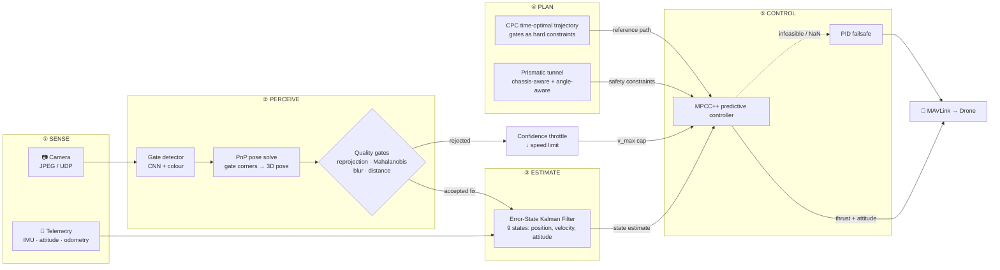
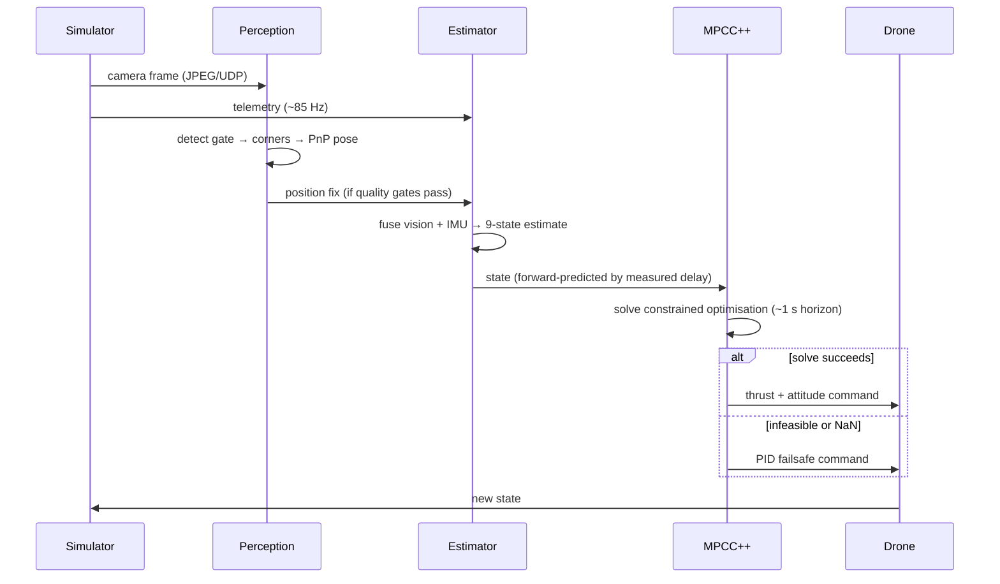
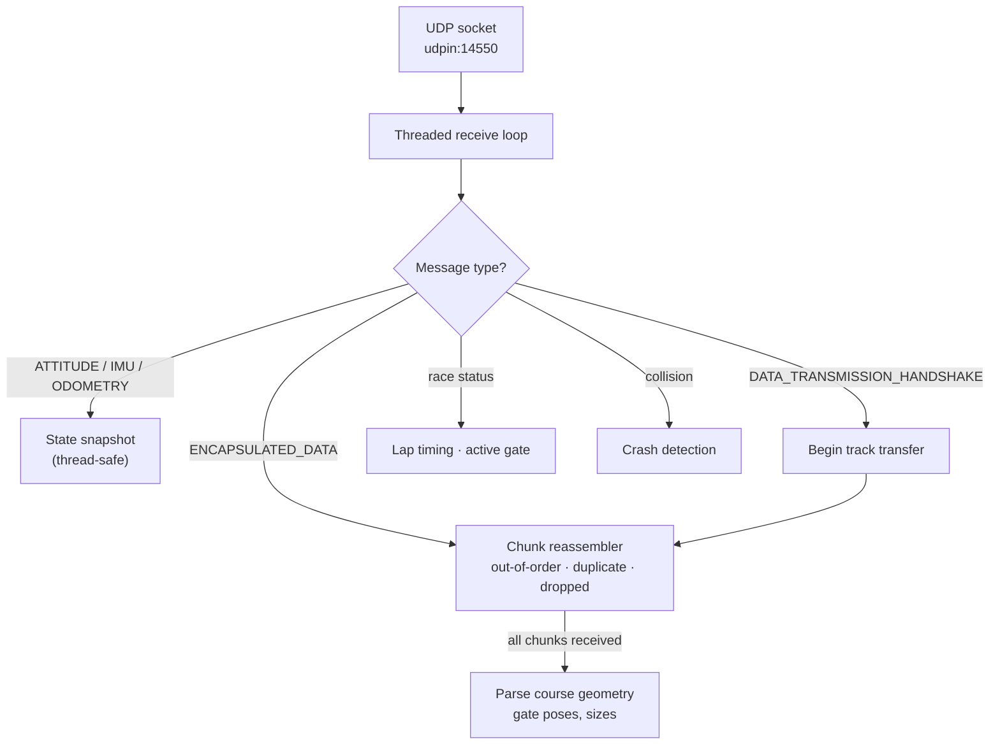
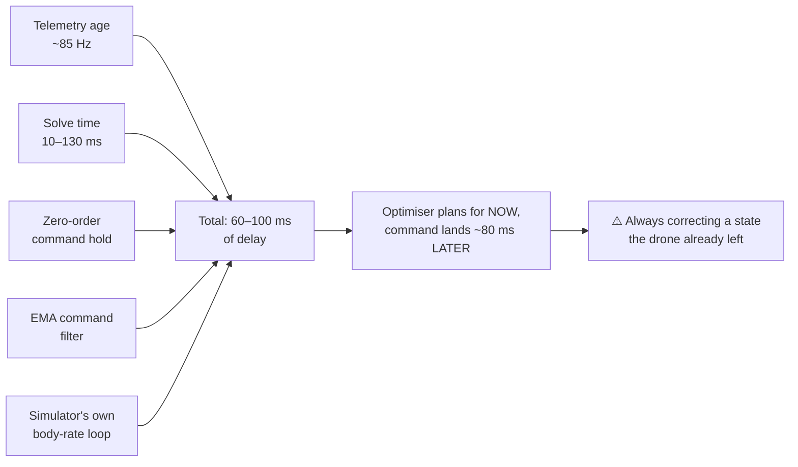
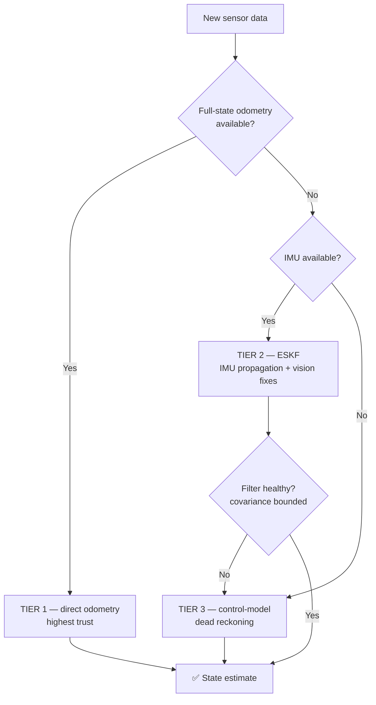
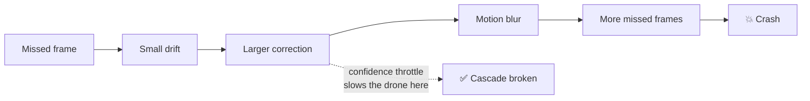
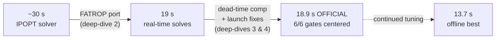

# AI Grand Prix 2026 — Autonomous Drone Racing

**An autonomy stack that flies a racing quadrotor through a gate course with zero human input.**

Built for the [AI Grand Prix 2026](https://www.theaigrandprix.com/) — a $500,000
autonomous drone-racing competition run by Anduril with the Drone Champions
League and Neros, with 2,700+ teams across 93 countries.

> ### 🏁 Virtual Qualifier 1: **COMPLETED**
> **18.9 s official run · 6 / 6 gates · every gate centered · 568 tests passing**

This repository is a **technical write-up**. The source code is private — see
[What's not here](#-whats-not-here).

---

## 📋 Contents

- [The problem](#-the-problem)
- [Results](#-results)
- [How the system works](#-how-the-system-works)
- [What happens every control tick](#-what-happens-every-control-tick)
- [Technical deep-dives](#-technical-deep-dives) — the hard problems
- [How the lap time came down](#-how-the-lap-time-came-down)
- [Engineering practice](#-engineering-practice)
- [Stack](#-stack)

---

## 🎯 The problem

The simulator gives you exactly two things, and expects flight commands back:

| Input | What it is |
|---|---|
| 📷 **Camera feed** | Chunked JPEG frames over UDP, from one forward-facing camera |
| 📡 **Telemetry** | IMU, attitude and odometry over MAVLink |

Everything in between is the work:

1. **See** the gates — from a single camera, with no GPS and no absolute position reference
2. **Localise** the drone in real time, fusing vision with IMU
3. **Plan** the fastest possible line through a sequence of gates
4. **Fly** it at racing speed, in a hard real-time loop, without crashing

All in Python, against an official technical specification, on a simulator whose
network interface had to be reverse-engineered before anything could fly at all.

---

## 📊 Results

| Metric | Result | Where measured |
|---|---|---|
| **Virtual Qualifier 1** | ✅ **Completed — 18.9 s, 6/6 gates** | Competition sim, **official clock** |
| **Gate accuracy** | All 6 gates centered (lateral error −0.8 → +0.5 m) | Competition sim |
| **Best offline iteration** | 13.7 s, 6/6 gates | Competition sim, unofficial clock |
| **Controller solve time** | 10–130 ms (adaptively compensated) | Measured in-loop |
| **State telemetry rate** | ~85 Hz (ODOMETRY) | Competition sim |
| **Automated tests** | **568, all passing** | Local |
| **Defects found & fixed** | ~70 across 13 engineering sessions | Documented changelog |

Scoring was best-of-many — unlimited attempts, best run counted. **18.9 s is the
banked official result** on a clean run with every gate centered.

---

## 🔧 How the system works

**In plain terms:** the camera finds gates and turns them into a position fix; that
fix is filtered together with the IMU into a best estimate of where the drone
actually is; a planner has already computed the fastest line through the course;
and a predictive controller works out the thrust and attitude needed to follow
that line — re-solving the whole optimisation several times per second.

### The two ideas that do the heavy lifting

**MPCC++ (Model Predictive Contouring Control)** — instead of just reacting to
where the drone is *now*, it simulates roughly one second into the future on every
tick and solves for the best command sequence. Crucially, it keeps "go fast" in
the cost function and puts "don't hit the gate" into **hard constraints**, so the
two goals can be tuned independently rather than fighting each other.

**CPC (Complementary Progress Constraints)** — the trajectory planner treats each
gate as a *region to pass through*, not a waypoint to hit dead-centre. The
optimiser chooses where in each gate opening to fly, which is what produces a real
racing line through corners instead of a zig-zag between gate centres.

---

## ⏱️ What happens every control tick

Note the **forward-prediction** step — that detail turned out to matter enormously
(see [deep-dive 3](#3-the-launch-wobble--unmodelled-actuation-delay)).

---

## 🔬 Technical deep-dives

These are the problems that actually consumed the time. Nearly all of them share
a theme: **the obvious explanation was the wrong one.**

### 1. Reverse-engineering the simulator protocol

The competition simulator is **not** a PX4 or ArduPilot autopilot — it is a custom
Unreal Engine / PhysX MAVLink emitter. I had originally built the comms layer on
MAVSDK (the standard library), and discovered it was *structurally incapable* of
driving this simulator:

- The **course geometry and race timing arrive as custom MAVLink messages**
  (`ENCAPSULATED_DATA`, plus a repurposed `DATA_TRANSMISSION_HANDSHAKE`) that
  MAVSDK's typed API cannot surface at all. Without them you have no course and
  no lap timer.
- There is **no offboard-mode handshake** — you arm and stream setpoints directly.

So I decoded the wire format byte-for-byte and **rebuilt the entire comms layer on
raw pymavlink**:

The binary layouts are pinned by **round-trip unit tests**, so a wire-format drift
can't silently corrupt the course mid-race.

**Result:** an adapter verified byte-for-byte against the official reference
client, plus 71 new tests.

---

### 2. Real-time nonlinear MPC — finding and breaking the solver wall

MPCC++ solves a constrained nonlinear optimisation on *every* control tick. Running
on IPOPT (a general-purpose interior-point solver) through CasADi, **the solve rate
was the hard ceiling on lap time** — the drone simply couldn't be commanded fast
enough to race.

The textbook answer is `acados`, but it requires a C toolchain the target machine
didn't have. Instead I moved to **FATROP** — a structure-exploiting optimal-control
solver reachable through CasADi — which meant restructuring the problem into the
*interleaved OCP form* its structure detection expects.

> **Result: lap time fell from roughly 30 s → 19 s.**

I later made the MPCC solve **asynchronous and non-blocking**, so a slow solve no
longer stalls the control loop waiting for it.

---

### 3. The launch wobble — unmodelled actuation delay

The drone oscillated on launch. The instinct is to retune controller gains — and
that would have been chasing the wrong thing entirely. Instrumenting the loop
revealed **60–100 ms of real transport delay**, stacked from five separate
sources:

**Fix — dead-time compensation:** forward-predict the state by the measured delay
*before* handing it to the optimiser, so it plans for where the drone *will be*
when the command actually lands. Made **adaptive** — base latency plus a running
average of actual measured solve time, since solve time varies by an order of
magnitude (10–130 ms).

---

### 4. The launch flip — yaw starvation

A violent flip and spin on takeoff looked like any number of classic culprits:
frame-convention error, gain instability, bad initial state. The real cause was
**yaw starvation** — the yaw channel was being out-competed for control authority,
and the optimiser was compensating by commanding roll.

> **The drone rolled because it could not yaw.**

**Fix:** clamp roll *and* yaw toward zero inside the launch window, plus a launch
pitch-angle cap. Gate 0 went from "flip" to centered.

---

### 5. Estimation that degrades instead of dying

Vision drops out constantly — gates leave the frame, motion blur destroys corner
detection, one gate occludes another. A naive filter diverges and the drone
crashes. This stack steps down through tiers instead:

Two more safeguards sit on top:

- **Quality gates** on every vision fix — distance, reprojection error,
  Mahalanobis test, temporal consistency, blur. A bad pose is rejected *before* it
  can poison the filter.
- **Confidence throttle** — when perception confidence drops, commanded speed drops
  with it. This deliberately breaks the classic failure cascade:

---

### 6. Designing the failure modes

Racing code fails at speed, so failure behaviour is **designed**, not hoped for:

- **MPCC++ → PID failsafe chain.** If the optimiser returns infeasible or NaN,
  control falls through to a PID that keeps the aircraft stable. A slow recovery
  beats a crash.
- **Hard tunnel constraints** rather than cost penalties — the optimiser *cannot*
  plan a path through a gate frame, rather than merely being discouraged from it.
- **Chassis-aware and angle-aware gate margins** — the constraint accounts for the
  drone's physical width, and for the fact that crossing a gate at an angle
  reduces the effective aperture it has to fit through.

---

## 📉 How the lap time came down

Each step was a different *kind* of problem: the first was computational
(solver throughput), the second physical (actuation delay), the third a control-
allocation conflict. None of them were fixed by tuning gains.

---

## 🧪 Engineering practice

The part that mattered as much as the algorithms:

- **568 automated tests**, run after every change. Binary wire formats, coordinate-
  frame conversions and solver edge cases (NaN gradients at zero velocity,
  degenerate short trajectories) are all pinned by tests.
- **A full written audit trail** — a session log and structured changelog recording
  every change, the reasoning behind it, and what was measured. 13 sessions,
  ~70 defects.
- **Verify-before-fix discipline.** Roughly **half of all candidate bugs raised
  during audit passes turned out to be false alarms**, so every candidate was
  reproduced and proven before anything was changed. That discipline caught several
  real, *silent* defects — including:
  - a configuration-propagation bug where calibration values **appeared** to apply
    but never actually reached the controllers (so the drone would have flown on
    uncalibrated placeholder constants while reporting success), and
  - a command-semantics mismatch that would have transmitted **attitude angles as
    angular rates** — catastrophic, and completely silent.
- **Literature-grounded.** Solver and control decisions were based on the published
  MPCC / MPCC++ and time-optimal trajectory research rather than guesswork.

---

## 🛠 Stack

**Python 3.14** · **CasADi** (FATROP / IPOPT) · **PyTorch** · **OpenCV** ·
NumPy / SciPy · **pymavlink** · pytest · AWS EC2 (GPU)

**Domains:** nonlinear model-predictive control · trajectory optimisation ·
state estimation (EKF / ESKF) · computer vision and pose estimation (PnP) ·
real-time systems · protocol reverse-engineering

---

## 🔒 What's not here

- **No source code.** The implementation is in a private repository — this document
  is a write-up of the engineering, not a code drop. I'm happy to walk through any
  part of it in detail, or demonstrate it running.
- **No competition assets.** No simulator binaries, course files, or any material
  from the competition package — none of that is mine to publish.

---

*Independent project, built solo.*
